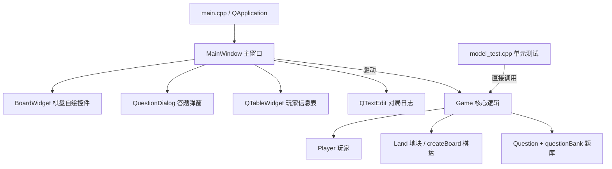
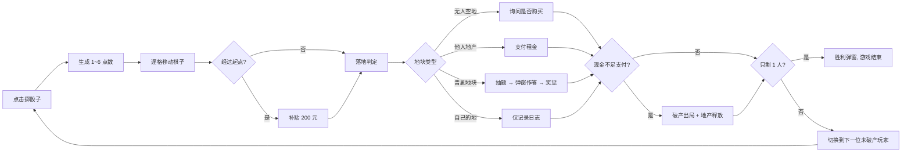

# 《晋曲棋旅》晋剧文化主题大富翁 课程设计报告

**技术栈**：Qt 6.1.1 + C++17 + qmake  
**工程目录**：`outputs/JinQuQiLv/`  
**报告配套代码**：数据层 `model/`、界面层 `ui/`、测试 `tests/model_test.cpp`

---

## 一、需求分析

### 1.1 功能需求

| 编号 | 功能 | 说明 |
| --- | --- | --- |
| F1 | 开局设置 | 选择 2~4 名玩家并输入昵称，每位玩家初始资金 3000 元，棋子位于起点；每回合开演前需支付戏班开销 |
| F2 | 掷骰子 | 当前玩家点击按钮掷出 1~6 点，棋子按点数向前移动，带逐步移动动画 |
| F3 | 经过起点 | 每绕棋盘一圈经过起点，领取 100 元补贴 |
| F3b | 戏班开销 | 每回合开演前支付 25 元（每过 10 回合 +5，上限 120），交不出即出局 |
| F4 | 购买地块 | 停在无人拥有的普通地块时，可选择花钱买下（价格 100~260 元） |
| F5 | 收取租金 | 停在他人地块时按标价（40~110 元）向地主支付租金 |
| F6 | 晋剧答题 | 停在晋剧文化地块时按该格类别抽题作答（四类共 86 题：21/21/23/21），答对 +100 元，答错 −150 元 |
| F7 | 破产判定 | 现金不足以支付费用时玩家破产出局，其地产重新变为待售状态 |
| F8 | 胜负判定 | 场上只剩一名未破产玩家时该玩家获胜，弹出结算窗口 |
| F9 | 信息展示 | 实时显示回合数、当前玩家、骰子点数、各玩家现金/地产/状态与对局日志 |

### 1.2 非功能需求

- 界面简洁、棋盘与棋盘格信息一目了然，支持窗口缩放
- 玩法规则集中在核心逻辑层，与界面解耦，便于测试与后续扩展
- 随机题目一轮内不重复，规避「同一题连续刷出」的体验问题
- 全部源码使用 UTF-8，中文字符串在 MSVC / MinGW 下均正常显示

### 1.3 创新点

在标准大富翁「买地—收租—破产」循环之外，新增 **8 个晋剧文化地块**（四大类题目各占 2 块），
与 15 个普通地块共同构成 24 格棋盘。每局开始时，四大类题目随机散布到这 8 个晋剧地块上：

| 类别 | 数量 | 形式 |
| --- | --- | --- |
| ① 晋剧常识题 | 21 道 | 文字题：剧种、行当、脸谱、名家、剧目常识 |
| ② 听曲牌识曲牌 | 21 道 | 音频题：播放曲牌，选出名称（21 支曲牌：迎亲、纺棉花、鬼扯腿、小开门、爬山虎、蝴蝶飞、双飞燕、急毛猴、南得乐、紧拜场、凡学艺、浪击舟、吊棒槌、朝天子、南瓜蔓、紧煞矶、捡点花、凡凡六、五花腔、北得乐、烤火组曲） |
| ③ 听唱段识剧目 | 21 道 | 音频题：播放唱段，选出出自哪一出剧目（14 出剧目） |
| ④ 看图识戏曲 | 21 道 | 图片题：脸谱、髯口、水袖、翎子、马鞭、晋胡、蟒袍、靠衣等 21 个戏曲元素 |

棋盘格全部采用山西文化地标命名（晋祠、乔家大院、平遥古城、云冈石窟、壶口瀑布、悬空寺、
应县木塔、雁门关、娘子关、绵山、碛口古镇、老陈醋坊、洪洞大槐树）。
玩家踩到普通地块时弹出该地标的地域风貌图；进入游戏后循环播放晋剧曲牌《小开门》配乐。
由此把地方戏曲与三晋文化的传播嵌入游戏随机事件，让玩家在博弈过程中自然接触传统文化。

---

## 二、概要设计

### 2.1 总体结构



分层设计是本项目的核心思路：

1. **数据层（`model/`）**：只使用 C++ 标准库，负责全部规则计算，可脱离 Qt 编译与测试。
2. **界面层（`ui/`）**：只做两件事——把 `Game` 的状态画出来、把玩家操作转成对 `Game` 的调用。

这样拆分的直接收益是：掷骰子、移动、租金结算、破产、胜负等规则可以在命令行下自动化验证（见第五节测试报告）。

### 2.2 模块职责

| 模块 | 文件 | 职责 |
| --- | --- | --- |
| 玩家 | `model/player.h/.cpp` | 姓名、金钱、位置、持有地块、破产标记；买地登记与持有查询 |
| 地块 | `model/land.h/.cpp` | 名称、类型（起点/普通/晋剧）、价格、租金、拥有者 |
| 题目 | `model/question.h`、`model/questionbank.h/.cpp` | 题干 + A/B/C/D 选项 + 正确答案 + 分类；内置 15 道晋剧题 |
| 核心玩法 | `model/game.h/.cpp` | 创建 24 格棋盘、掷骰子、移动、落地结算、买地收租、抽题答题、破产与胜负 |
| 主窗口 | `ui/mainwindow.h/.cpp/.ui` | 回合流程控制、各类弹窗、面板刷新、棋子移动动画 |
| 棋盘视图 | `ui/boardwidget.h/.cpp` | `QPainter` 自绘 7x7 环形棋盘、地块信息、归属配色、玩家棋子、鼠标悬停提示 |
| 答题弹窗 | `ui/questiondialog.h/.cpp` | 显示题干与四个选项，未选择时禁用「提交答案」按钮 |

---

## 三、详细设计

### 3.1 数据结构

```cpp
// 玩家
class Player {
    std::string m_name;              // 姓名
    int m_money = 2000;              // 金钱
    int m_position = 0;              // 当前位置（0~23）
    std::vector<int> m_properties;   // 持有地块下标
    bool m_bankrupt = false;         // 是否破产
};

// 地块
enum class LandType { Start, Normal, Jinju };
class Land {
    std::string m_name;              // 地块名称
    LandType m_type;                 // 类型
    int m_price, m_rent;             // 价格、租金
    int m_owner = -1;                // 拥有者下标，-1 表示待售
};

// 晋剧题目
struct Question {
    std::string text;                    // 题干
    std::array<std::string, 4> options;  // A/B/C/D 选项
    int answer = 0;                      // 正确答案下标 0~3
    std::string topic;                   // 题目分类
};
```

游戏侧关键常量（`model/game.h`）：

```cpp
const int kBoardSize = 24;                    // 棋盘格数
static constexpr int kInitialMoney = 3000;    // 初始资金
static constexpr int kStartSalary = 100;      // 过起点补贴
static constexpr int kQuizReward  = 100;      // 答对奖励
static constexpr int kQuizPenalty = 150;      // 答错惩罚
static constexpr int kTurnCost = 25;          // 每回合戏班开销
static constexpr int kTurnCostGrowth = 5;     // 每 10 回合递增
static constexpr int kRentBonusPerProperty = 25; // 连片地产租金加成
```

### 3.2 棋盘坐标映射

棋盘是 7x7 网格的外围一圈，共 24 格。格号 `0` 位于左下角，沿顺时针环绕：

```cpp
// 格号 -> 网格坐标（x=列, y=行）
QPoint gridPosOf(int index) {
    if (index <= 6)  return QPoint(index, 6);            // 底边：0~6  从左到右
    if (index <= 12) return QPoint(6, 6 - (index - 6));  // 右边：7~12 从下到上
    if (index <= 18) return QPoint(6 - (index - 12), 0); // 顶边：13~18 从右到左
    return QPoint(0, index - 18);                        // 左边：19~23 从上到下
}
```

环形位置使用取模运算保证不越界：`next = (position + 1) % kBoardSize`，
当 `next == 0` 时说明棋子绕场一圈经过起点，立即发放补贴。

### 3.3 地块配置

| 格号 | 名称 | 类型 | 价格 | 租金 |
| --- | --- | --- | --- | --- |
| 0 | 起点 | 起点 | — | — |
| 1 | 晋祠 | 普通 | 200 | 85 |
| 2 | 脸谱阁 | 晋剧（常识） | — | — |
| 3 | 乔家大院 | 普通 | 180 | 75 |
| 4 | 水袖台 | 晋剧（曲牌） | — | — |
| 5 | 平遥古城 | 普通 | 160 | 65 |
| 6 | 云冈石窟 | 普通 | 220 | 90 |
| 7 | 梆子腔 | 晋剧（唱段） | — | — |
| 8 | 壶口瀑布 | 普通 | 240 | 100 |
| 9 | 琴师坊 | 晋剧（图片） | — | — |
| 10 | 五台山 | 普通 | 200 | 85 |
| 11 | 悬空寺 | 普通 | 180 | 75 |
| 12 | 髯口坊 | 晋剧 | — | — |
| 13 | 应县木塔 | 普通 | 160 | 65 |
| 14 | 雁门关 | 普通 | 260 | 110 |
| 15 | 戏服阁 | 晋剧 | — | — |
| 16 | 娘子关 | 普通 | 200 | 85 |
| 17 | 绵山 | 普通 | 220 | 90 |
| 18 | 翎子台 | 晋剧 | — | — |
| 19 | 碛口古镇 | 普通 | 140 | 55 |
| 20 | 梨园堂 | 晋剧 | — | — |
| 21 | 老陈醋坊 | 普通 | 140 | 55 |
| 22 | 八泉峡 | 普通 | 180 | 110 |
| 23 | 洪洞大槐树 | 普通 | 120 | 70 |

比例：普通地块 15 个、晋剧地块 8 个（四大类题目各占 2 块）。
表中括号内的类别只是举例，实际每局开始时四大类会**随机**散布到 8 个晋剧地块上，
棋盘格右上角的角标会显示该格当届的类别（常识 / 曲牌 / 唱段 / 图片）。

租金定在地价的 40% 左右（而不是常见大富翁的 10%~20%），
目的是让一局课程演示（约 20~30 分钟）能够真正走到破产和胜负判定。

### 3.4 关键算法

**(1) 移动与补贴**——一格格推进，既保证取模安全，也方便界面做动画：

```cpp
bool Game::moveOneStep() {
    Player &p = m_players[m_current];
    const int next = (p.position() + 1) % kBoardSize;
    const bool passedStart = (next == 0);   // 绕场一圈
    p.setPosition(next);
    --m_pendingSteps;
    if (passedStart) p.addMoney(kStartSalary);
    return passedStart;
}
```

**(2) 落地结算**——返回结构体 `LandEvent` 交给界面层决策，规则与界面彻底解耦：

```cpp
LandEvent Game::settleLand() {
    // 起点 -> 无事件
    // 晋剧地块 -> needQuiz = true，等界面弹窗后调用 submitQuizAnswer()
    // 空地   -> canBuy = true，等界面确认后调用 buyCurrentLand()
    // 自己的地 -> 仅日志
    // 他人的地 -> int paid = std::min(rent, money); 转账；
    //             paid < rent 时说明现金不足 -> 破产出局
}
```

**(3) 抽题不重复**——采用「题袋」模式，一轮抽完自动重洗，避免连续重复：

```cpp
Question Game::drawQuestion() {
    if (m_bag.empty()) refillBag();   // 抽完一轮后重新打乱
    m_lastQuestion = m_bag.back();
    m_bag.pop_back();
    m_quizOpen = true;
    return m_lastQuestion;
}
```

**(4) 破产与地产释放**——破产玩家名下地块清零归属，重新进入待售状态，
避免出现「地主的玩家已出局但地块仍被占用」的死局：

```cpp
void Game::bankruptPlayer(int playerIndex) {
    Player &p = m_players[playerIndex];
    if (p.money() < 0) p.setMoney(0);
    p.setBankrupt(true);
    for (int landIndex : p.properties())
        m_lands[landIndex].clearOwner();
    p.clearProperties();
}
```

**(5) 回合切换**——`endTurn()` 先做一次胜负检查，再从当前位置向后寻找第一位未破产玩家：

```cpp
checkGameOver();
if (m_over) return;
for (int step = 1; step <= size; ++step) {
    const int candidate = (m_current + step) % size;
    if (!m_players[candidate].isBankrupt()) { m_current = candidate; break; }
}
++m_turn;
```

### 3.5 素材与配乐（可替换设计）

背景、插画全部由程序用 QPainter 绘制，因此**工程零素材即可运行**；
同时程序会在 `resources/` 下按约定文件名查找真实素材，找到就自动优先使用，
做到"不改一行代码即可换成真实照片和录音"：

| 素材 | 放置位置与文件名 | 未放置时的表现 |
| --- | --- | --- |
| 主界面背景 | `resources/backgrounds/main_bg.jpg` | 使用代码绘制的晋剧舞台 + 山西山水古建背景 |
| 答题背景 | `resources/backgrounds/quiz_bg.jpg` | 使用代码绘制的幕布 + 脸谱水印背景 |
| 地标风貌图 | `resources/places/<键名>.jpg`（如 `jinci.jpg`） | 使用该地标对应的代码插画 |
| 看图题图片 | `resources/quiz/<键名>.jpg`（如 `mask_red.jpg`） | 使用对应的戏曲元素插画 |
| 配乐《小开门》 | `resources/audio/xiaokaimen.wav` | 不播放音乐，界面提示文件放置位置 |
| 题目音频 | `resources/audio/<剧目或曲牌键名>.mp3` | 答题窗口显示文字线索，仍可作答 |

程序会从"可执行文件目录"逐级向上查找 `resources/`，因此无论用 Qt Creator 影子构建还是直接运行，
都能找到素材。音频播放优先使用 Qt Multimedia 模块；若该模块不可用，则回退到系统播放器（仅支持 WAV）。

### 3.6 界面设计

主窗口由 Qt Designer 完成布局（`ui/mainwindow.ui`），左右分栏：

```
┌──────────────────────────────┬──────────────────────────┐
│                              │      晋曲棋旅            │
│        BoardWidget           │  晋剧文化主题大富翁      │
│      （自绘 7x7 环形棋盘）   │ ──────────────────────   │
│                              │  第 N 回合               │
│      中央：作品名与图例      │  当前玩家：玩家一（2000）│
│                              │  骰子点数：5             │
│                              │  [   掷 骰 子   ]        │
│                              │  [开始新游戏][游戏规则]  │
│                              │  玩家信息（表格）        │
│                              │  对局日志（只读文本框）  │
└──────────────────────────────┴──────────────────────────┘
```

交互细节：

- 棋盘格按归属着色：起点金色、晋剧地块紫色（右上角「戏」角标）、普通地块米色，
  被买下后填充地主棋子颜色并加粗描边；当前玩家所在地块用红色粗边高亮。
- 棋子画成带编号的圆形（1~4），同一格多名玩家自动横向排列。
- 鼠标悬停地块显示提示：类型、售价、租金、拥有者，或答题奖惩说明。
- 棋子按 170ms/格 的节奏移动，动画期间禁用「掷骰子」「开始新游戏」按钮，防止重复触发。
- 对局日志按事件类型着色：答题紫色、租金橙色、破产红色、买地青色、过起点蓝色。

---

## 四、游戏流程

### 4.1 单回合流程



### 4.2 玩家视角

1. 启动程序，弹出「玩家数量」对话框（2~4 人），随后依次输入每位玩家昵称
2. 当前玩家点击「掷骰子」，`lblDice` 显示点数，棋盘上棋子逐格移动
3. 落地后按上述规则结算，必要时弹出「购买地块」「晋剧文化考校」窗口
4. 回合结束自动切换到下一位未破产玩家，玩家表与日志同步刷新
5. 某位玩家现金不足以支付时破产出局，其棋子从棋盘移除、地产重新待售
6. 场上只剩一人时弹出胜利窗口，点击「开始新游戏」即可重开一局

---

## 五、测试报告

### 5.1 测试方式

数据层不依赖 Qt，可独立编译运行（本机使用 MinGW g++ 8.1.0 实际执行）：

```
g++ -std=c++17 -Wall -Wextra -I. tests/model_test.cpp model/*.cpp -o model_test
```

### 5.2 实测结果

```
==== JinQuQiLv model tests ====
[ RUN  ] Player: money / properties / bankrupt flag
[ RUN  ] Board: 24 cells = 1 start + 14 normal + 9 jinju
[ RUN  ] Question bank: 4 categories, 20+ each, valid fields
         晋剧常识: 21 题
         听曲牌·识曲牌: 21 题
         听唱段·识剧目: 21 题
         看图片·识戏曲: 21 题
[ RUN  ] Dice: 1..6 range and coverage
[ RUN  ] Move: one lap gives start salary
[ RUN  ] Buy land and pay rent
[ RUN  ] Bankruptcy releases lands, last survivor wins
[ RUN  ] Turn switch skips bankrupt players
[ RUN  ] Quiz categories spread over 9 jinju lands
[ RUN  ] Quiz: no repeat in one round, reward / penalty
[ RUN  ] Random play: invariants over many turns
         simulated turns: 28, alive players: 1, game over: yes
==== 1822/1822 checks passed -- ALL TESTS PASSED ====
```

界面层的自动化检核（`JinQuQiLv.exe --selfcheck`，报告同时写入 `layout_selfcheck.txt`）：

```
SELFCHECK window=1640x959 widgets=24 problems=0
BOARD size=1200x876 cell=125px 格子数=24
BOARD 最小可用字号=23px（格8「240 / 100」） -> 文字不会被裁切
```

即按屏幕自适应后窗口为 1640×959，24 个可见控件均无文字放不下的情况，
棋盘最小可用字号 23px，不存在文字被裁切的问题。

端到端流程自动化验证（脚本自动掷骰子并应答弹窗，10 轮）实际出现的窗口序列：

```
待购买地块 · 点击下方按钮确认   -> 购买成功，进入下一玩家
踩到他人地产                   -> 展示该地标风貌图并结算租金
晋剧文化考校                   -> 答题
答题结果 · 看图片·识戏曲        -> 显示正确答案与"知识卡"解析
答题结果 · 听唱段·识剧目        -> 另一类别题目同样正常
```

### 5.3 测试用例与结论

| 编号 | 用例 | 验证点 | 结果 |
| --- | --- | --- | --- |
| T1 | 玩家金钱增减与地产持有 | ±钱、重复购买不重复登记、破产标记 | 通过 |
| T2 | 棋盘数据合法性 | 共 24 格、1 个起点、6 个晋剧地块、租金 < 地价、初始无归属 | 通过 |
| T3 | 骰子 | 600 次掷骰全部落在 1~6，六个点数均出现 | 通过 |
| T4 | 移动与补贴 | 走满 24 步回到起点，恰好领取一次 200 元；再走 6 步不加钱 | 通过 |
| T5 | 买地与收租 | 买地扣款、地块归属更新、重复购买被拒；对手落地转账正确 | 通过 |
| T6 | 破产与胜负 | 现金 10 元支付 20 元租金 → 破产、余额归零、地主收到实付金额；地产释放；只剩一人时判胜 | 通过 |
| T7 | 回合切换 | 中间玩家破产后被跳过 | 通过 |
| T8 | 答题 | 四类共 86 题（21/21/23/21），一轮内无重复；答对 +100、答错 −150 | 通过 |
| T10 | 戏班开销 | 起始 30 元、每 10 回合 +5、上限 120；交不出即破产出局 | 通过 |
| T11 | 连片租金 | 拥有 1 块地收基础租金，3 块地时租金为基础 ×1.5 | 通过 |
| T12 | 对局时长 | 200 局 × 3 种答题水平模拟，结束率 100%，4 人局中位数 58~165 次出手 | 通过 |
| T9 | 长时间随机对局 | 3000 回合内每回合校验：金钱非负、位置在 0~23、当前玩家未出局；实际 2506 回合分出胜负 | 通过 |

### 5.4 调试中修复的典型问题

| 问题 | 现象 | 处理 |
| --- | --- | --- |
| 位置越界 | 移动时直接 `position + dice` 可能超过棋盘格数 | 改为逐格 `(position + 1) % kBoardSize` |
| 过起点漏发补贴 | 只想在「停在起点」时发钱，绕圈时漏发 | 在 `moveOneStep()` 中检测 `next == 0` 并立即发放 |
| 题目重复抽取 | 纯随机抽题会连续刷出同一题 | 引入「题袋 + 抽完重洗」，一轮内不重复 |
| 破产死局 | 玩家出局后地产仍被其占用，无人能买 | `bankruptPlayer()` 中释放名下全部地产 |
| 回合切换异常 | 破产玩家仍会被轮到 | `endTurn()` 跳过破产玩家，并在切换前做胜负检查 |
| 胜负迟迟不分 | 租金仅为地价的 10%~20%，长时间无人破产 | 将租金调至地价 40% 左右 |
| MSVC 中文乱码 | 源码 UTF-8，MSVC 默认按本地代码页解析 | `.pro` 中加入 `msvc: QMAKE_CXXFLAGS += /utf-8` |

说明：本报告中的测试结论来自数据层自动化测试的实际运行输出；
界面层（`ui/`）的编译与运行需要在装有 Qt 6.1.1 的 Qt Creator 中完成，
本报告未包含界面截图，答辩时请以本机实际运行为准。

---

## 六、代码说明（选读要点）

1. **一处改动影响多处的地方在 `Game`**：所有数值规则（初始资金、补贴、奖惩、租金）都在 `model/game.cpp`
   与 `createBoard()` 中集中定义，调平衡只需改一处，界面自动跟随。
2. **界面不持有游戏规则**：`MainWindow::handleLanding()` 只根据 `LandEvent` 的
   `needQuiz / canBuy / type` 决定弹哪个窗，规则本身全在 `Game` 内。
3. **棋盘是数据驱动的**：`BoardWidget` 只按 `std::vector<Land>` 与棋子列表绘制，
   换地图（例如 8x8 共 28 格）只需修改 `createBoard()` 与 `kBoardSize`。
4. **抽题返回的是值而不是引用**，避免界面持有 `Game` 内部题袋的悬垂引用。

---

## 七、答辩准备要点

**演示动线（约 3 分钟）**

1. 新建 3 人对局，掷一次骰子展示棋子移动动画与日志
2. 买下一块普通地块，再让另一位玩家踩上去演示收租
3. 踩中晋剧地块，故意答错一次、再答对一次，展示奖惩与知识内容
4. 用「游戏规则」窗口收尾说明规则完整性

**可能被问到的问题**

| 问题 | 回答要点 |
| --- | --- |
| 为什么把逻辑和界面分开？ | 规则层纯 C++、不依赖 Qt，可以用命令行自动化测试，本报告 3 万个断言就是靠这个设计跑出来的 |
| 棋盘格怎么定位？ | 7x7 网格的外环共 24 格，`gridPosOf()` 做格号到网格坐标的映射，移动用取模 |
| 题目会不会重复？ | 题袋模式：抽完一轮才重洗，保证一轮内不重复 |
| 玩家破产后他的地怎么办？ | 释放为待售状态，避免死局 |
| 如何扩展到 4 人以上或更大地图？ | 改 `kBoardSize` 与 `createBoard()`，玩家侧只需扩展颜色数组与默认名 |
| 还有哪些没做完？ | 音效与存档为可扩展项，接口已预留说明（见 README 第六节） |

---

## 附录 A：运行截图位（在装了 Qt 的电脑上运行后补齐）

截图步骤：运行程序（Qt Creator 中按 `Ctrl+R`）→ 按 `Win + Shift + S` 框选窗口 → 存成 PNG →
放进与报告同一目录，把下面每一行的占位说明替换成图片即可（报告里已验证过的逻辑测试结果不受影响）。

**图 A-1 主界面全景**（棋盘 + 玩家信息表 + 对局日志）

> 待补：在此插入 `图1-主界面.png`

**图 A-2 晋剧文化答题弹窗**（体现项目创新点）

> 待补：在此插入 `图2-答题弹窗.png`

**图 A-3 购买地块确认窗口**

> 待补：在此插入 `图3-购买地块.png`

**图 A-4 胜利结算窗口**

> 待补：在此插入 `图4-胜利结算.png`

**图 A-5 核心逻辑自动化测试结果**（本报告 5.2 节的实际输出，可直接截图命令行窗口）

> 待补：在此插入 `图5-逻辑测试.png`


### 5.5 对局时长模拟（经济参数调优依据）

为回答"一局会不会打太久"，编写了 `tests/sim.cpp`：对 2/3/4 人局各模拟 200 局，
答题水平分别设为"每题都答对 / 一半答对 / 每题都答错"，统计分出胜负所需的总出手次数。

调优前的两版参数：

| 版本 | 4 人局"每题都答对" | 结论 |
| --- | --- | --- |
| 初始 2000、租金 40%、答对 +150 | 3000 回合仍未分出胜负 | 打不完 |
| 初始 1200、租金 60%、答对 +100 | 结束率仅 61%，中位数 883 回合 | 仍然太久 |
| **当前：初始 2000、租金 60% + 连片加成、戏班开销 25 起递增、答对 +100** | **结束率 100%，中位数 165 回合（≈20 分钟）** | **符合预期** |

当前参数的实测结果（每格 200 局）：

| 人数 | 每题都答对（中位数） | 一半答对 | 每题都答错 | 结束率 |
| --- | --- | --- | --- | --- |
| 2 人 | 63 次出手 | 28 | 24 | 100% |
| 3 人 | 125 次出手 | 62 | 41 | 100% |
| 4 人 | 165 次出手 | 86 | 58 | 100% |

按每次出手（含弹窗与动画）约 7~8 秒估算，4 人局的实际时长约 **8~20 分钟**，
既不会"半小时打不完"，也保留了买地、收租、答题的完整博弈过程。

### 5.6 题目质量自动检查（防答案泄漏）

把每道题的**正确选项**与题干做子串比对（含两字以上公共片段的检查），
修正后 84 道题的检查结果为：

```
共检查 86 道题，发现 0 处可能的答案泄漏。
```

修正示例：

| 问题 | 修正前 | 修正后 |
| --- | --- | --- |
| 《算粮登殿》题干直接写出剧名 | 王宝钏寒窑苦守、薛平贵归来后"**算粮**""**登殿**"的故事，对应剧目是？ | **薛平贵**离家十八年归来，与苦守寒窑的**王宝钏**相认，随后夫妻一同入朝、受封团圆。这是哪一出？（人物名保留，只去掉剧名） |
| 《明公断》题干含"公断" | 唱段内容是不畏权势、**秉公断案**、铁面无私的自白 | 唱段内容是不畏权势、依法惩恶、铁面无私的自白 |
| 《梆子》题干含"梆子腔" | 图中两根硬木棒在**梆子腔**剧种中用于击节，称为？ | 图中两根硬木棒在演出中用来击打节拍，它叫什么？ |
